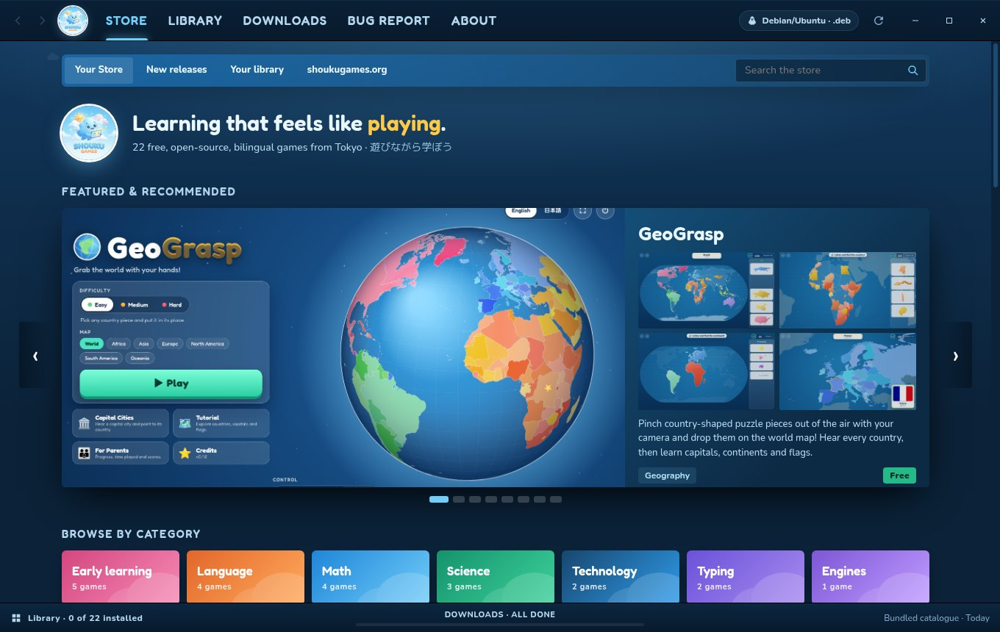
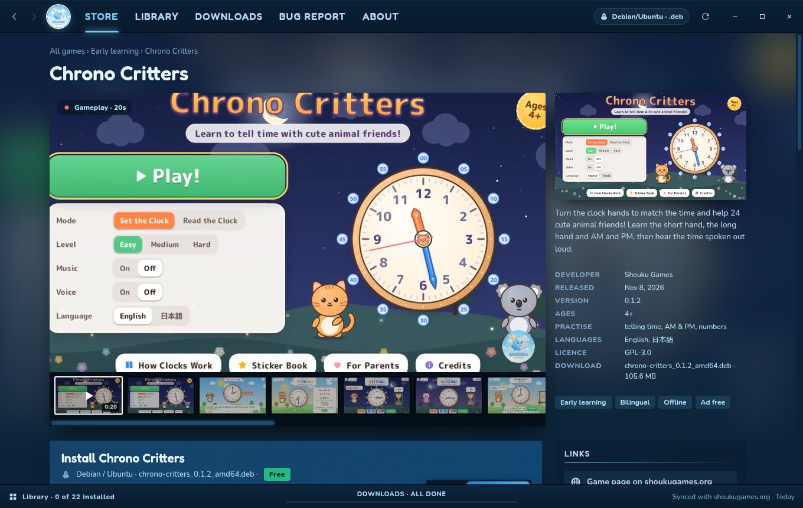
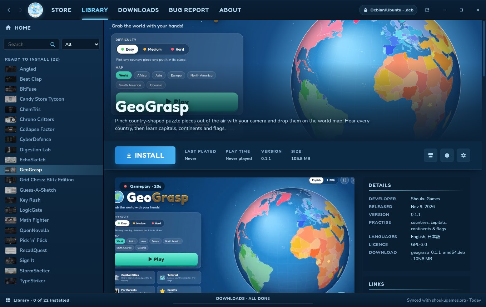
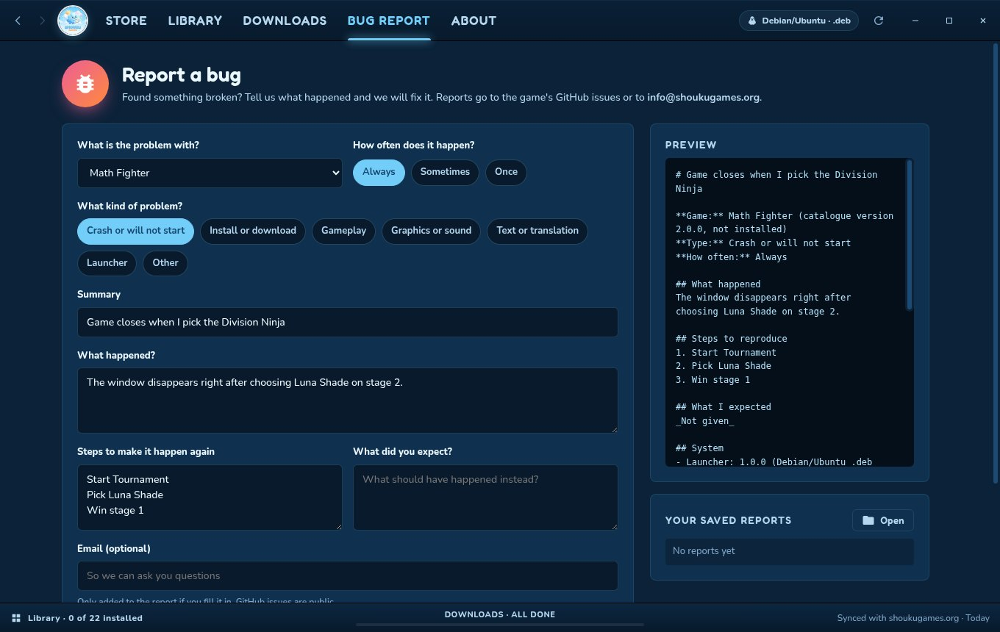
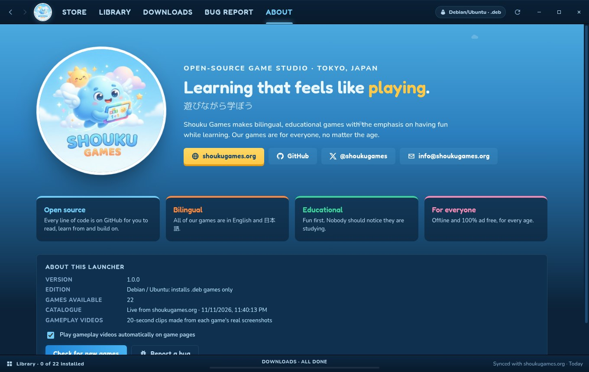

<p align="center">
  
</p>

<h1 align="center">Shouku Launcher</h1>

<p align="center">
  A Steam-style desktop launcher for every game on <a href="https://shoukugames.org/">shoukugames.org</a>.<br>
  Open-source, bilingual, educational games from Tokyo, Japan. <i>遊びながら学ぼう</i>
</p>



## Features

- **Store**: featured carousel with hover-to-play gameplay video, category tiles, and a searchable list with a preview pane.
- **Game pages**: title, full description, every screenshot (with lightbox), a **20-second gameplay video**, version, age rating, licence, download size, and links to the website and GitHub.
- **Library**: Steam-style sidebar with search and filters, a big **Install / Play / Update** button, play-time and last-played tracking, and a *Manage* menu (browse files, set game file, reinstall, uninstall).
- **Downloads**: queue with progress, speed, cancel and retry. Progress also shows in the status bar.
- **Bug report page**: guided form (game, kind of problem, how often, steps, expected result) with a live Markdown preview. It can open a pre-filled GitHub issue on the right repository, send an email to info@shoukugames.org, save the report as a file, or copy it.
- **Always current**: the catalogue is bundled for offline use and refreshed from shoukugames.org at start-up (or with the ⟳ button), so new games show up without a launcher update.
- **Shouku look**: the website's logo, Fredoka and Nunito fonts, and its sky blue, ink, sun, mint and pink palette on a Steam-like dark layout.

| Game page | Library |
|---|---|
|  |  |

| Bug report | About |
|---|---|
|  |  |

## Two editions

| | Windows | Debian / Ubuntu |
|---|---|---|
| Version | 1.1.0 | 1.0.0 |
| Package | `ShoukuLauncher-Setup-<version>.msi` (Windows Installer), or the portable `ShoukuLauncher-<version>-win-x64.zip` | `shouku-launcher_<version>_amd64.deb` |
| Games it offers | **only the Windows `.exe` builds** | **only the `.deb` packages** |
| How games install | Portable games are saved to `%LOCALAPPDATA%\ShoukuGames\Library\<game>`; installer-type games run silently into that folder | `apt-get install` through `pkexec` (you're asked for your password), so dependencies are handled |
| How games uninstall | Runs the game's uninstaller, then removes its folder | `apt-get remove` |

The platform split is enforced three times: `scripts/stage-platform.js` bundles only one platform's
catalogue into each package, the launcher filters the live catalogue by platform at run time, and the
downloader refuses any file that isn't `.exe` (Windows) or `.deb` (Linux), or that comes from any host
other than shoukugames.org. `npm run check` opens both finished packages and verifies this.

Game installers are **not** bundled inside the launcher. They are downloaded from shoukugames.org when
you press *Install*, just like Steam.

### Installing the launcher

Download it from **<https://shoukugames.org/shouku-launcher/>** (the *Shouku Launcher* tab at the top
right of the website). How the page is set up and how to publish a new version is in
[`website/README.md`](website/README.md).

**Windows**: double-click `ShoukuLauncher-Setup-1.1.0.msi`. It installs for the current user into
`%LOCALAPPDATA%\Programs\Shouku Launcher` without asking for an administrator password, and adds
Start-menu and desktop shortcuts. Remove it from *Settings → Apps*. Or extract the portable
`ShoukuLauncher-1.1.0-win-x64.zip` anywhere and run `Shouku Launcher.exe`.
The packages aren't code-signed yet, so SmartScreen may say "Windows protected your PC". Click
*More info*, then *Run anyway*.

There is deliberately **no self-extracting `.exe`**: those unpack programs into `%TEMP%` and run them
from there, which antivirus heuristics flag. The MSI is handled by Windows Installer itself, and the
zip is a plain folder.

**Debian / Ubuntu**:

```sh
sudo apt install ./shouku-launcher_1.0.0_amd64.deb
```

It recommends `pkexec` (to install games with a password prompt) and `fonts-noto-cjk` (for Japanese text).

## Building

Requirements: Node.js 18 or newer, npm, and internet access (to read shoukugames.org).
Building the `.deb` needs `dpkg-deb` and `fakeroot`, which any Debian/Ubuntu system has.
Building the Windows MSI needs `wixl` from msitools (`sudo apt install wixl`), or set `WIXL=/path/to/wixl`.

```sh
npm install

npm run dist:linux     # -> dist/shouku-launcher_1.0.0_amd64.deb
npm run dist:win       # -> dist/ShoukuLauncher-Setup-1.1.0.msi + dist/ShoukuLauncher-1.1.0-win-x64.zip
npm run dist           # both
npm run check          # verify both packages (platform split, videos, screenshots)
```

Both editions are built on Linux and **no Wine is needed**. `scripts/build-win.js` has electron-builder
lay the app out as a normal folder (`dist/win-unpacked`) and zip it, then turns the same folder into an
MSI with `wixl`. The Windows edition's version is `windowsVersion` in `package.json`; the Linux edition
uses `version`.

The first build downloads the content automatically. You can also run the steps yourself:

| Command | What it does |
|---|---|
| `npm run content` | Reads every game from shoukugames.org (WordPress REST API and game pages) and downloads all screenshots into `build/content/` |
| `npm run videos` | Makes the 20-second gameplay video for each game (`-- --force` to rebuild, `-- <slug>` for one game) |
| `npm start` | Runs the launcher from source |
| `npm run stage:win` / `stage:linux` | Copies a single platform's catalogue and media into `build/stage/` for packaging |

### Gameplay videos

shoukugames.org has screenshots but no video clips, so `npm run videos` makes each game's 20-second
video from its real screenshots (pan and zoom motion, cross-fades, Shouku watermark) using the bundled
`ffmpeg-static`. To use a real screen recording instead, drop it into [`videos/`](videos/README.md)
as `<slug>.mp4` and run `npm run videos -- <slug>`. It is trimmed to 20 seconds automatically.

## Project layout

```
src/main/main.js        Electron main process: window, catalogue, IPC, bug reports
src/main/library.js     Downloads, install / play / uninstall for Windows and Debian
src/main/scraper.js     Reads the catalogue from shoukugames.org (shared with the build scripts)
src/main/preload.js     The small, safe API the UI is allowed to use
src/renderer/           The Steam-style UI (HTML, CSS, JS, fonts, logo)
scripts/                Content download, video maker, platform staging, Windows build, package checks
resources/              App icons (from the Shouku Games logo)
videos/                 Optional real gameplay recordings
website/                The "Shouku Launcher" tab and download page on shoukugames.org
build/, dist/           Generated (git-ignored)
```

## Where things are stored

| | Windows | Linux |
|---|---|---|
| Settings, play time, logs, saved bug reports | `%APPDATA%\Shouku Launcher` | `~/.config/Shouku Launcher` |
| Games | `%LOCALAPPDATA%\ShoukuGames\Library` | installed system-wide by apt |

## Reporting bugs

Use the **Bug report** tab in the launcher. Reports about a game open an issue on that game's GitHub
repository; reports about the launcher go to
[shoukugames/shoukulauncher](https://github.com/shoukugames/shoukulauncher/issues).
You can also email info@shoukugames.org.

## Licence

GPL-3.0-or-later. See [LICENSE](LICENSE). Game descriptions, screenshots and the Shouku Games logo
belong to Shouku Games. Fredoka and Nunito are under the SIL Open Font License.
